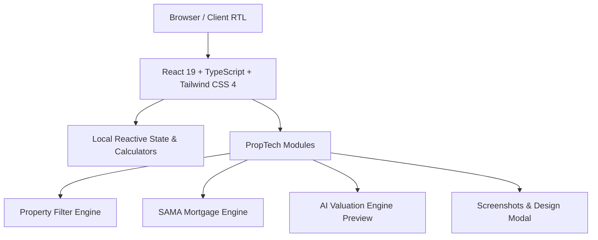

# EDRAK Real Estate (منصة إدراك العقارية) 🏢🇸🇦

[](https://react.dev/)
[](https://www.typescriptlang.org/)
[](https://vitejs.dev/)
[](https://tailwindcss.com/)
[](LICENSE)

**EDRAK (إدراك)** is a modern, high-performance **PropTech UI/UX Platform Prototype** engineered for the Saudi real estate ecosystem. Designed specifically around Arabic RTL typography, intuitive investor dashboards, and interactive property analytics, EDRAK showcases an enterprise-grade front-end design system tailored for commercial and residential real estate brokers, developers, and institutional investors.

---

## 🌟 Key Features & Interactive Modules

- 🧮 **Interactive Mortgage & Financing Calculator:**
  - Real-time client-side calculation enforcing Saudi Central Bank (SAMA) financial guidelines (e.g., maximum 45% Debt-to-Income / DTI limit).
  - Dynamic sliders for monthly income, down payment, and repayment period (years).
  - Instant estimates for total borrowing capacity and monthly installments across government, private, and military sectors.

- 🗺️ **Property Explorer & Dynamic Filter Engine:**
  - Fast, in-memory multi-attribute filtering (Deal Type: Sale / Rent / Investment; Category: Residential Land, Luxury Villas, Commercial Offices).
  - Instant city and district keyword search.
  - Interactive property pin cards with detailed metadata (square meter prices, street dimensions, zoning).

- 🤖 **AI Valuation & Market Intelligence Interface:**
  - Interactive preview for real estate appraisal algorithms based on neighborhood growth metrics, municipal zone coefficients, and historical transaction data.

- 📊 **Executive Investor Command Center:**
  - High-level portfolio tracking metrics (total portfolio asset valuation, transaction volume, active finance requests, expected annual yield).
  - Categorized breakdowns for construction materials, general contracting, and municipal engineering consultants.

- 🎨 **Enterprise UI / UX & Design System:**
  - Dual theme architecture: **High-contrast Dark Mode** & **Clean Modern Light Mode**.
  - Built natively for **Right-To-Left (RTL)** Arabic rendering with Cairo typography.
  - Smooth micro-interactions powered by **Lucide Icons** and Tailwind CSS transitions.
  - High-fidelity visual showcase modal displaying architecture mockups and responsive interfaces.

---

## 🛠️ Architecture & Tech Stack



| Layer | Technology | Details |
|---|---|---|
| **Core Framework** | **React 19** | Modern functional components, React Hooks (`useState`, `useMemo`, `useEffect`) |
| **Language** | **TypeScript 5.7** | Strict typing for component props, data models, and financial calculation payloads |
| **Styling** | **Tailwind CSS v4** | Modern CSS engine with `@tailwindcss/vite`, glassmorphism effects, custom animations |
| **Icons & Assets** | **Lucide React** | Feather-light SVG icon system |
| **Build Tooling** | **Vite 6** | Lightning-fast HMR and optimized tree-shaken static production bundle |
| **Deployment** | **Netlify** | Automated SPA deployment with custom redirects and CDN edge caching |

---

## 📁 Repository Structure

```text
EDRAK-Real-Estate/
├── docs/                      # Architectural plans and specifications
│   └── PROJECT_PLAN.md        # Comprehensive PropTech development roadmap
├── public/                    # Static public assets (images, logos, favicon)
│   └── images/                # High-resolution property and blueprint captures
├── src/
│   ├── components/            # Reusable UI widgets & functional sections
│   │   ├── AIValuationSection.tsx
│   │   ├── Footer.tsx
│   │   ├── HeroSection.tsx
│   │   ├── LandPlotsSection.tsx
│   │   ├── MortgageCalculator.tsx
│   │   ├── Navbar.tsx
│   │   ├── PropertyMapPreview.tsx
│   │   ├── ScreenshotsShowcase.tsx
│   │   └── ServicesGrid.tsx
│   ├── pages/                 # Full platform page views
│   │   ├── AICenterPage.tsx
│   │   ├── BuildingMaterialsPage.tsx
│   │   ├── ConsultantsPage.tsx
│   │   ├── ContactPage.tsx
│   │   ├── ContractorsPage.tsx
│   │   ├── DashboardPage.tsx
│   │   ├── DevelopersPage.tsx
│   │   ├── HomePage.tsx
│   │   ├── InvestmentsPage.tsx
│   │   ├── LandPlotsPage.tsx
│   │   ├── MortgagePage.tsx
│   │   └── PropertyMapPage.tsx
│   ├── types/                 # TypeScript interfaces and domain schemas
│   │   └── index.ts
│   ├── App.tsx                # Main application wrapper with theme & view manager
│   ├── index.css              # Global styles, Tailwind directives & typography
│   └── main.tsx               # DOM entry point
├── netlify.toml               # Continuous deployment configuration
├── package.json               # Dependencies and build scripts
├── tsconfig.json              # TypeScript compilation rules
└── vite.config.ts             # Vite bundler configuration
```

---

## 🚀 Getting Started Locally

### Prerequisites
- **Node.js** `>= 18.0.0`
- **npm** or **pnpm**

### Installation & Run

1. **Clone the repository:**
   ```bash
   git clone https://github.com/Aymn-Ahmed/EDRAK-Real-Estate.git
   cd EDRAK-Real-Estate
   ```

2. **Install dependencies:**
   ```bash
   npm install
   ```

3. **Start the local development server:**
   ```bash
   npm run dev
   ```
   Open your browser at `http://localhost:5173`.

4. **Build for production:**
   ```bash
   npm run build
   ```
   Production artifacts will be generated in `dist/`.

---

## 🔮 Engineering Roadmap

- [ ] **Full-Stack REST API Integration:** Transition from in-memory mock datasets to ASP.NET Core or Node.js backend.
- [ ] **Declarative Routing:** Migrate tab-based navigation state to `react-router-dom` v7 with deep-linking support.
- [ ] **Interactive GIS Mapping:** Integrate Mapbox GL / Leaflet for interactive geospatial plot exploration.
- [ ] **Wathq & Real Estate Registry Integration:** Live API verification for Saudi deeds (صكوك عقارية).

---

## 📄 License
This project is licensed under the MIT License - see the [LICENSE](LICENSE) file for details.
